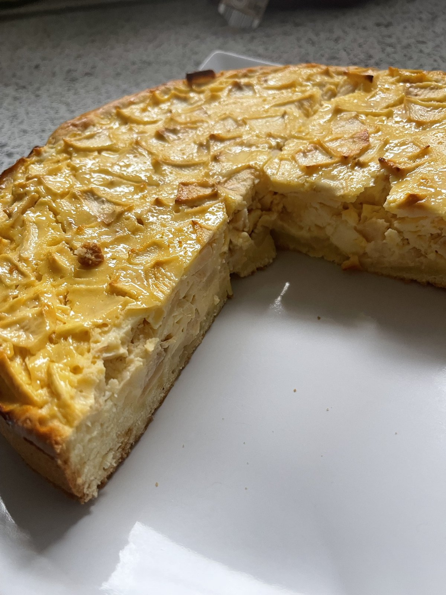

# Apfelkuchen mit Quark

Rührteigboden mit Zimt und cremiger Quark-Apfel-Füllung, irgendwo zwischen Apfel- und Käsekuchen. Schmeckt am besten kalt.

## Utensilien

- Springform, 26 cm
- kleiner Teigroller

## Zutaten

### Boden

- 125 g Butter
- 80 g Zucker
- 3 Eier
- 250 g Mehl
- 1/2 TL Backpulver
- 1 TL Zimt
- 1 TL Vanillepaste
- 50 ml Milch

### Füllung

- 750 g säuerliche Äpfel
- 250 g Magerquark
- 70 g Zucker
- 3 Eier
- 1/2 Zitrone (Saft)
- 1 TL Vanillepaste
- 1 Päckchen Vanillepuddingpulver

## Zubereitung

1. Ofen auf 180 °C Ober-/Unterhitze vorheizen, Springform einfetten.
2. **Boden:** Butter mit Zucker und Vanillepaste cremig aufschlagen, dann die Eier einzeln einarbeiten.
3. Mehl mit Backpulver und Zimt vermengen, unter den Teig kneten und zum Schluss die Milch einrühren.
4. Teig in die Form geben und mit dem Teigroller so verteilen, dass ein etwa 3 cm hoher Rand entsteht.
5. **Füllung:** Quark, Zucker, Vanillepaste, Puddingpulver, Eier und Zitronensaft zu einer glatten Creme verrühren.
6. Äpfel schälen, Kerngehäuse entfernen, in etwa 1,5 cm große Würfel (Spielwürfel-Größe) schneiden und unter die Creme heben.
7. Füllung auf den Boden geben und auf mittlerer Schiene backen; bräunt die Oberfläche zu früh, mit Alufolie abdecken. ⏱ 55 min
8. Vollständig abkühlen lassen und anschließend im Kühlschrank durchziehen lassen. ⏱ 3 h
9. Kalt servieren, ohne Puderzucker oder Guss.

## Notizen

- Backzeit laut Quelle 50–60 min – Stäbchenprobe machen.
- Am besten kalt essen, gern schon am Vortag backen.
- Zucker gegenüber dem Original reduziert (Boden 100 → 80 g, Füllung 90 → 70 g); Zimt im Teig ergänzt; kein Puderzucker/Guss.
